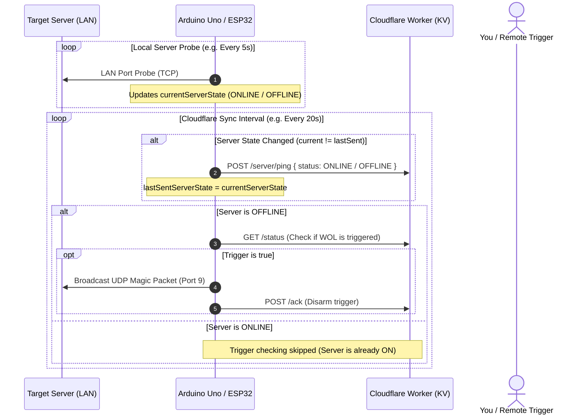

# cf-wake-on-lan

An Always-On Device (AOD) Wake-on-LAN (WOL) remote server starter powered by **Cloudflare Workers + Cloudflare KV (100% Free Tier)**.

### 🔌 Hardware Configuration
- **Primary Board**: **Arduino Uno R3 + ESP8266 ESP-12E WiFi Shield** (Dedicated Always-On WOL Controller)
- **Alternative / Backup Board**: **ESP32 Dev Board** (Alternative standalone firmware included)

---

## ⚡ Smart Polling & Trigger Flow



### 🧠 Flow Benefits:
1. **Separated Intervals**: Local LAN server probe runs fast (e.g., every 5s) without consuming internet bandwidth or Cloudflare quotas.
2. **State Memory (`current` vs `lastSent`)**: Cloudflare is only notified when the status actually changes, minimizing HTTP calls.
3. **Conditional Wake Checking**: When the server is already `ONLINE`, the board avoids unnecessary trigger processing. As soon as the server is `OFFLINE`, it monitors for WOL triggers on every sync cycle.

---

## 📁 Repository Structure

```
├── cloudflare-worker/
│   ├── package.json
│   ├── wrangler.toml
│   └── src/
│       └── index.js
├── firmware/
│   ├── config.h.example
│   ├── esp32/
│   │   └── esp32_wol.ino
│   └── arduino_uno_esp8266/
│       └── arduino_uno_esp8266_wol.ino
├── .gitignore
└── README.md
```

---

## 🚀 Cloudflare Worker Setup (Free Tier)

You can deploy the Worker directly from this repository using either the **Cloudflare Dashboard (Git Integration)** or the **Wrangler CLI**.

### Option 1: Direct Cloudflare Dashboard (Deploy from Git)
1. Push this repository to your GitHub/GitLab account.
2. In the **Cloudflare Dashboard**:
   - Go to **Workers & Pages** -> **Create application** -> **Workers** -> Select **Connect to Git**.
   - Select your repository (`cf-wake-on-lan`).
   - The root [`wrangler.toml`](file:///Users/janlofredy/Documents/ServerStarter/wrangler.toml) will be detected automatically.
3. In **Settings -> Bindings**:
   - Add a **KV namespace binding**:
     - Variable name: `WOL_STORE`
     - KV namespace: Select or create `WOL_STORE`.
4. In **Settings -> Variables and Secrets**:
   - Add Secret: `API_KEY` (set your secret authorization token).
5. Click **Save and Deploy**. Cloudflare will automatically build and deploy every time you push changes!

---

### Option 2: Deploy via CLI (Wrangler)
1. Log in to Cloudflare:
   ```bash
   npx wrangler login
   ```
2. Create the free KV namespace:
   ```bash
   npx wrangler kv namespace create WOL_STORE
   ```
3. Copy the generated `id` and paste it into [`wrangler.toml`](file:///Users/janlofredy/Documents/ServerStarter/wrangler.toml).
4. Set your secret token:
   ```bash
   npx wrangler secret put API_KEY
   ```
5. Deploy:
   ```bash
   npm run deploy
   ```

---

### 2. Microcontroller Setup

#### 🌟 Recommended: Direct Flashing to ESP8266 (Bypass AT Commands)
Instead of dealing with flaky factory AT firmware, baud rate mismatches, and `SoftwareSerial` overhead between the Uno and ESP, **flash code directly to the ESP-12E module on the shield**. The ESP8266 has a 32-bit CPU and its own Wi-Fi/UDP stack, making it far faster, more stable, and self-contained!

##### 📺 Reference Guides & Videos
- **[Instructables Setup Guide: ESP8266 ESP-12E UART Wireless WIFI Shield TTL Converter](https://www.instructables.com/ESP8266-ESP-12E-UART-Wireless-WIFI-Shield-TTL-Conv/)**
- **[Part 1: Arduino Uno + ESP8266 WiFi Shield Setup Guide (YouTube)](https://www.youtube.com/watch?v=Y1GWoiuE-Ls)**
- **[Part 2: Uploading & Testing WebServer Example directly on ESP8266 (YouTube)](https://www.youtube.com/watch?v=jCL4VuFRKvQ)**

> [!NOTE]
> **Board Identification ("MOER" vs "MORE")**:
> Check the white silkscreen text printed on your WiFi shield near the ESP-12 module:
> - **`"Moer info & tech"`** (or `"Moer info $ tech"`): A common clone printing misspelling (often manufactured by WangTongze / Doit clones). As highlighted in the community and Instructables guides, this variant often has DIP switch / hardware serial routing conflicts with the Arduino's D0/D1 pins, which is why flashing the ESP8266 module directly (or bypassing the Uno via RESET-to-GND) is strongly recommended over relying on factory AT firmware!
> - **`"More info & tech"`**: Standard silkscreen printing.

---

##### 🛠️ How to Flash Directly to the ESP8266 (Bypassing AT Commands)

1. **Silence the Arduino Uno MCU (USB-to-Serial Bridge Mode)**:
   - Connect a DuPont jumper between the Arduino Uno **`RESET`** pin and **`GND`**.
   - *(This halts the Uno's ATmega328P so its onboard USB-UART chip speaks directly to the ESP8266).*

2. **Set Shield DIP Switches to Flash Mode**:
   - Set **DIP 1**: `OFF`
   - Set **DIP 2**: `OFF`
   - Set **DIP 3**: `ON` (pulls GPIO0 LOW for download boot mode)
   - Set **DIP 4**: `ON`

3. **Bridge Serial Communication (Uno <-> ESP8266)**:
   - Connect Shield **`TX` / `TXD`** $\rightarrow$ Arduino Uno **`D1` (TX)** (or D0 depending on shield routing).
   - Connect Shield **`RX` / `RXD`** $\rightarrow$ Arduino Uno **`D0` (RX)** (or D1 depending on shield routing).
   - *Note*: Because the Uno MCU is bypassed, connect `TX` to `TX` and `RX` to `RX` so the USB-Serial bridge routes directly to the ESP.

4. **Arduino IDE Setup**:
   - Go to **Boards Manager** and install **`esp8266 by ESP8266 Community`** (version 2.7.4 or 3.x).
   - Select Board: **`Generic ESP8266 Module`**.
   - Flash Size: **`4MB (FS:2MB OTA:~1019KB)`** (or `512KB` depending on your ESP-12 chip variant).
   - Upload Speed: **`115200`**.

5. **Upload & Run**:
   - Copy [`firmware/esp8266_standalone_wol/config.h.example`](file:///Users/janlofredy/Documents/ServerStarter/firmware/esp8266_standalone_wol/config.h.example) to `firmware/esp8266_standalone_wol/config.h` and fill in your WiFi and Cloudflare details.
   - Open [`firmware/esp8266_standalone_wol/esp8266_standalone_wol.ino`](file:///Users/janlofredy/Documents/ServerStarter/firmware/esp8266_standalone_wol/esp8266_standalone_wol.ino).
   - Press the **ESP-RST** button on the shield right before uploading.
   - Click **Upload**.
   - **Switch to Run Mode**: Once flashed, switch **DIP 3 to `OFF`** and **DIP 4 to `OFF`** (DIP 1 & 2 `ON` or maintain bridge), then press **ESP-RST**. The ESP8266 will boot the standalone firmware directly!

---

#### 🔌 Legacy Option: Arduino Uno running AT Commands
*(If you specifically want the Arduino Uno ATmega328P to orchestrate the ESP8266 over SoftwareSerial)*
1. Mount the ESP8266 ESP-12E WiFi shield directly on top of the Arduino Uno.
2. Shield DIP switches: Set all to `OFF` (1: OFF, 2: OFF, 3: OFF, 4: OFF).
3. Connect jumpers: Shield `TX` $\rightarrow$ Uno `D2`, Shield `RX` $\rightarrow$ Uno `D3`.
4. Open [`firmware/arduino_uno_esp8266_wol/arduino_uno_esp8266_wol.ino`](file:///Users/janlofredy/Documents/ServerStarter/firmware/arduino_uno_esp8266/arduino_uno_esp8266_wol.ino).
5. Configure credentials in `config.h`, select **Arduino Uno**, and upload.

---

#### 🔄 Alternative Choice: ESP32 Dev Board (Backup Option)
*(Use this if you ever repurpose the Arduino or need a standalone board)*
1. In Arduino IDE:
   - Install **ESP32 by Espressif Systems** via Boards Manager.
   - Install **ArduinoJson** via Library Manager.
2. Copy `firmware/config.h.example` to `firmware/config.h` and populate your network & Cloudflare credentials.
3. Open [`esp32_wol.ino`](file:///Users/janlofredy/Documents/ServerStarter/firmware/esp32/esp32_wol.ino), select your ESP32 board, and upload.

---

### 3. Triggering Wake-on-LAN from Anywhere

Send an authenticated HTTP POST request to trigger the server boot from anywhere (curl, iOS Shortcuts, Tasker, or browser):

```bash
curl -X POST "https://YOUR_WORKER_SUBDOMAIN.workers.dev/trigger" \
  -H "Authorization: Bearer YOUR_SECRET_TOKEN" \
  -H "Content-Type: application/json"
```

*(Optional)* Trigger a specific MAC address dynamically:
```bash
curl -X POST "https://YOUR_WORKER_SUBDOMAIN.workers.dev/trigger" \
  -H "Authorization: Bearer YOUR_SECRET_TOKEN" \
  -H "Content-Type: application/json" \
  -d '{"mac": "11:22:33:44:55:66"}'
```

---

## ⚙️ Free Tier Quota Details (Cloudflare KV)
- **Reads**: 100,000 / day
- **Writes**: 1,000 / day
- At a 30-second polling interval: `(86,400s / 30s) = 2,880 reads/day` (under **3%** of the free daily limit).
