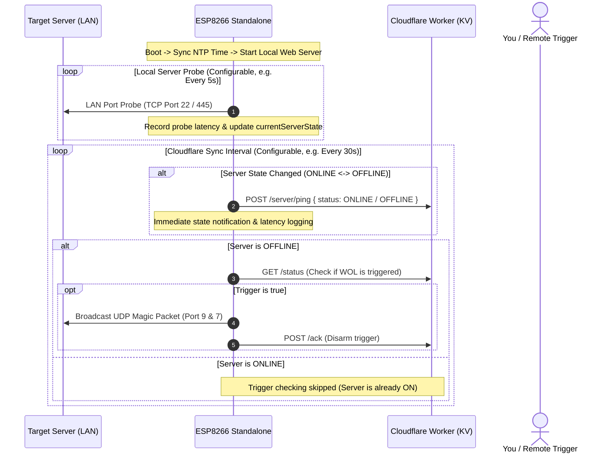

# cf-wake-on-lan

An Always-On Device (AOD) Wake-on-LAN (WOL) remote server starter powered by **ESP8266 Standalone Firmware + Cloudflare Workers + Cloudflare KV (100% Free Tier)**.

### 🔌 Hardware Configuration
- **Board**: **ESP8266 (ESP-12E WiFi Shield or Standalone NodeMCU/Wemos)**
  - Runs natively on the 32-bit ESP8266 module with its own hardware Wi-Fi and UDP stack.
  - No AT command overhead, no SoftwareSerial bottlenecks.
  - Fully independent, low-power, always-on IoT controller.

---

## ⚡ Architecture & Dual Polling Flow



### 🧠 Core Features:
1. **First-Time Setup & Fallback AP Portal (`ServerStarter-Setup`)**:
   - Automatically starts an open setup network at `http://192.168.4.1` with DNS captive portal redirection if unconfigured or on Wi-Fi connection timeout (~25s).
   - Background verification tests Wi-Fi credentials before switching modes so you are never locked out.
   - Configures Wi-Fi credentials, Cloudflare host/token, target MAC/IP, timezone offset, and polling intervals directly in the browser.
2. **NTP Date & Time Synchronization**:
   - Background SNTP synchronization via `pool.ntp.org` and `time.google.com`.
   - Displays real-time timestamps (`YYYY-MM-DD HH:MM:SS`) with persistent timezone offset.
3. **Comprehensive Device & Network Telemetry**:
   - **Device Lifecycle**: Boot Timestamp, Reset Reason (*Power On*, *Hardware Watchdog*, *Software Restart*), Uptime, Current & Lowest Free Heap.
   - **Target Server Probe**: Last Successful Ping, Last Failed Ping, Probe Latency (ms), Total Probes, Consecutive Failures, and Success Rate (%).
   - **Cloudflare Integration**: Last Sync HTTP Status, Round-Trip Latency (ms), Sync Success Rate (%), Last Successful/Failed Syncs, and Total WOL Dispatches.
   - **Wi-Fi Diagnostics**: RSSI (dBm & %), Reconnection Counter, IP, Gateway, Subnet, and Hostname.
4. **Rolling 10-Request Activity Log**:
   - In-memory circular buffer recording the last 10 actions (`CF /server/ping`, `CF /status`, `CF /ack`, `LAN Probe`, `WOL Packet`) with execution timestamps, status codes, and latency.
5. **Configurable Polling Intervals**:
   - Local LAN probe rate (default: 5s) and Cloudflare sync rate (default: 30s) are fully editable via the Web UI and saved to persistent EEPROM.
6. **Ultra-Minimal Plain Table Web UI & JSON API**:
   - Ultra-fast, lightweight plain-table dark theme dashboard at `http://serverstarter.local`.
   - Machine-readable JSON telemetry endpoint at `/status`.

---

## 📁 Repository Structure

```
├── cloudflare-worker/
│   ├── package.json
│   ├── wrangler.toml
│   └── src/
│       └── index.js                    # Cloudflare Worker & Web Dashboard UI
├── firmware/
│   ├── config.h.example                # Configuration template
│   └── esp8266_standalone_wol/
│       ├── config.h                    # Local fallback configuration
│       ├── config.h.example            # Module configuration template
│       ├── storage.h                   # 256-byte EEPROM persistent storage management
│       ├── time_service.h              # NTP clock synchronization & uptime formatting
│       ├── telemetry.h                 # Device metrics & rolling 10-request activity log
│       ├── wol.h                       # UDP Wake-on-LAN magic packet multi-broadcast
│       ├── cf_client.h                 # Cloudflare HTTP client & LAN TCP reachability probe
│       ├── network_portal.h            # Wi-Fi Station, fallback Setup AP & captive portal
│       ├── web_server.h                # Ultra-minimal Web UI, /status API & setup handlers
│       └── esp8266_standalone_wol.ino  # Lean main orchestrator (setup & loop)
├── test_wol.py                         # Local Python Wake-on-LAN diagnostic script
├── wrangler.toml                       # Cloudflare Worker configuration
└── README.md
```

---

## 🚀 Setup Guide

### 1. Cloudflare Worker Setup (Free Tier)

Deploy the Cloudflare Worker using either the Cloudflare Dashboard or Wrangler CLI.

#### Deploy via Wrangler CLI:
1. Log in to Cloudflare:
   ```bash
   npx wrangler login
   ```
2. Create the KV namespace:
   ```bash
   npx wrangler kv namespace create WOL_STORE
   ```
3. Copy the returned `id` and paste it into [`wrangler.toml`](wrangler.toml).
4. Set your secret device and user access tokens:
   ```bash
   npx wrangler secret put API_KEY
   ```
5. Deploy:
   ```bash
   npm run deploy
   ```

---

### 2. ESP8266 Flashing Guide (ESP-12E WiFi Shield on Arduino Uno)

Flashing directly to the ESP-12E module bypasses the Arduino MCU, running the standalone firmware with full speed and zero SoftwareSerial bottlenecks.

#### Step 1: Silence Arduino Uno MCU (USB-to-UART Bridge Mode)
- Connect a DuPont jumper between the Arduino Uno **`RESET`** pin and **`GND`**.
*(This halts the ATmega328P so the Uno onboard USB-UART chip speaks directly to the ESP8266).*

#### Step 2: Set Shield DIP Switches to Flash Mode
- **DIP 1**: `OFF`
- **DIP 2**: `OFF`
- **DIP 3**: `ON` (pulls GPIO0 LOW for download boot mode)
- **DIP 4**: `ON`

#### Step 3: Wire Serial Jumpers
- Connect Shield **`TX` / `TXD`** $\rightarrow$ Arduino Uno **`D1` (TX)** (or D0 depending on shield variant).
- Connect Shield **`RX` / `RXD`** $\rightarrow$ Arduino Uno **`D0` (RX)** (or D1 depending on shield variant).

#### Step 4: Arduino IDE Configuration
1. In Arduino IDE, open **Settings / Preferences** and add the ESP8266 URL to **Additional Boards Manager URLs**:
   ```
   http://arduino.esp8266.com/stable/package_esp8266com_index.json
   ```
2. Open **Tools > Board > Boards Manager**, search for **`esp8266`**, and install **`esp8266 by ESP8266 Community`**.
3. Select Board: **`Tools > Board > ESP8266 Boards > Generic ESP8266 Module`**.
4. Flash Size: **`4MB (FS:2MB OTA:~1019KB)`** (or `512KB` depending on your chip).
5. Upload Speed: **`115200`**.

#### Step 5: Upload Firmware
1. Open [`firmware/esp8266_standalone_wol/esp8266_standalone_wol.ino`](firmware/esp8266_standalone_wol/esp8266_standalone_wol.ino).
2. Press the **ESP-RST** button on the shield.
3. Click **Upload** in Arduino IDE.

#### Step 6: Switch to Run Mode
Once flashing finishes:
1. Switch **DIP 3 to `OFF`** and **DIP 4 to `OFF`**.
2. Set **DIP 1 to `ON`** and **DIP 2 to `ON`** (or leave jumpers connected to Uno).
3. Press **ESP-RST** to boot into production mode!

---

## 📶 First-Time Wi-Fi & Cloudflare Onboarding

1. On first boot (or if Wi-Fi cannot be reached within 25 seconds), the device starts an Access Point:
   - **SSID**: `ServerStarter-Setup`
   - **Gateway IP**: `http://192.168.4.1`
2. Connect your phone or laptop to `ServerStarter-Setup`. The captive portal will open automatically (or navigate to `http://192.168.4.1/setup`).
3. Select your local Wi-Fi from the network scan dropdown and fill in:
   - Wi-Fi Password
   - Cloudflare Host (`cf-wake-on-lan.<your-subdomain>.workers.dev`)
   - Secret Auth Token
   - Target Server MAC & IP
   - Timezone (e.g. `8` for UTC+8)
   - Probe Rate (e.g. `5` seconds) & CF Sync Rate (e.g. `30` seconds)
4. Click **Verify & Save Configuration**. The ESP8266 tests the connection in the background. If valid, it saves to persistent EEPROM, shuts down the setup AP, and connects to your network.

---

## 🖥️ Local Web UI & JSON API

Access the local dashboard on your network at:
- **`http://serverstarter.local`** (via mDNS)
- Or **`http://<ESP_DEVICE_IP>`**

### Endpoints:
- `GET /`: Ultra-minimal dark theme dashboard displaying server status, full telemetry, Cloudflare stats, rolling 10-request activity log, and quick configuration form.
- `GET /status`: Machine-readable JSON telemetry API.
- `POST /trigger`: Dispatches UDP Wake-on-LAN packet immediately.
- `POST /update-config`: Updates Target MAC, IP, Timezone, and polling rates in EEPROM.
- `POST /reset-setup`: Re-enters `ServerStarter-Setup` AP mode on demand.

---

## 🌐 Triggering Wake-on-LAN Remotely

Send an authenticated HTTP POST request to trigger the server boot from anywhere (curl, iOS Shortcuts, Tasker, Home Assistant, or browser):

```bash
curl -X POST "https://YOUR_WORKER_SUBDOMAIN.workers.dev/trigger" \
  -H "Authorization: Bearer YOUR_SECRET_TOKEN" \
  -H "Content-Type: application/json"
```

*(Optional)* Trigger a specific MAC address dynamically:
```bash
curl -X POST "https://YOUR_WORKER_SUBDOMAIN.workers.dev/trigger" \
  -H "Authorization: Bearer YOUR_SECRET_TOKEN" \
  -H "Content-Type: application/json" \
  -d '{"mac": "00:11:22:33:44:55"}'
```

---

## ⚙️ Cloudflare KV Free Tier Quota Details
- **Reads**: 100,000 / day
- **Writes**: 1,000 / day
- At a 30-second polling interval: `(86,400s / 30s) = 2,880 reads/day` (under **3%** of the free daily limit).
- State-change-only and throttled 15-minute keepalives keep KV writes well under **100 writes/day** (under **10%** of the 1,000 free writes).
